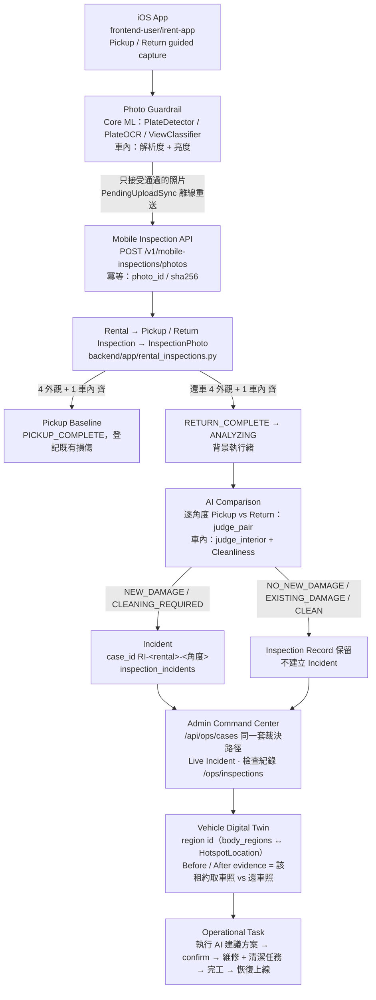

# End-to-End：iOS App → Backend → AI 比對 → Incident → Fleet Command Center

一筆租約 `RNT-20261005-1842`（ABC-1234 Toyota Yaris）可以從既有 iOS App 一路追到指揮中心的 Digital Twin 與整備任務。

> 核心訊息：**使用者端確保資料可信，AI 判斷車況變化，管理者端將異常轉換成營運行動。**
> Capture trustworthy evidence. Understand what changed. Act immediately.



## 哪些是真實 implementation、哪些是 deterministic demo fixture

| 環節 | 真實 implementation | Competition demo fixture（只對示範租約生效） |
|---|---|---|
| iOS 拍攝防呆 | `OnDeviceRecognitionService`：真實 Core ML（車牌偵測 → OCR → 視角分類 → 解析度）；車內照走解析度＋亮度 guard | 設定頁「Demo 模式」開啟時 `DemoCaptureScenario`：取車左前第一次「畫面模糊」、還車右後第一次「角度／距離不對」，重拍通過；其餘一律通過。關閉即回到真實 Core ML |
| 上傳 / 離線 | `InspectionSyncService` 擴充 metadata（photo_id、vehicle_id、inspection_type、photo_category、angle、validation_mode）；`PendingUploadSync` 依拍攝順序重送，4xx 不再重試並顯示原因 | — |
| 照片入庫 | `rental_inspections.ingest_photo()`：UNIQUE(rental, 階段, 角度, sha256) 冪等；狀態機 CREATED → PICKUP_IN_PROGRESS → PICKUP_COMPLETE → RETURN_IN_PROGRESS → RETURN_COMPLETE → ANALYZING → ANALYSIS_COMPLETE / ANALYSIS_FAILED | — |
| Pickup Baseline | 照片集合 + `existing_damage: []`（既有損傷由還車比對的 `pre_existing_notes` 帶出） | `demo_inspection_fixture.baseline()`：右前保險桿既有刮痕 87%（EXISTING_DAMAGE） |
| Return 比對 | `_real_analysis()`：逐角度 `judge_photos.judge_pair`（Gemini Flash 快篩 → Pro 級聯）、車內 `judge_interior`；沒有 GEMINI_API_KEY → ANALYSIS_FAILED，紀錄保留、不擋還車 | `demo_inspection_fixture.analysis()`：右後車門刮痕 0.92 MEDIUM NEW_DAMAGE、右前 EXISTING_DAMAGE、左前／左後 NO_NEW_DAMAGE、車內 髒汙 0.88（食物包裝／飲料杯／座椅污漬） |
| Incident | `_write_results()`：只有 NEW_DAMAGE / CLEANING_REQUIRED 建案；case_id 穩定，重跑覆寫；已裁決的案件不刪 | 同一條程式路徑，只是輸入來自 fixture |
| 裁決 / 任務 | `server._case_snapshot()` 的 `RI-` 分支 → 既有 `post_decision` → `tasks` → webhook；fleet 狀態由任務／鎖定／未裁決案件推導 | — |
| Admin | `/api/ops/cases` 合併 `rental_inspections.ops_cases()`；新增 `/api/ops/inspections`（列表／詳情）與 `/ops/inspections` 頁面；`demoVehicleId` 優先顯示 App 產生的主角車 | 後端 `DEMO_MODE=true` 啟動時若示範租約沒有任何照片，用資料集既有照片當佔位照直接落地 ANALYSIS_COMPLETE（管理者端不依賴 iOS）；「重置 Demo」同樣重新落地 |
| Digital Twin | 後端 `body_regions.py` 產生 twin region id（與前端 `HotspotLocation` 同一組 id）；前端 `resolveRegion()` 優先吃後端 id，拿不到才用關鍵字推斷。Before/After 證據讀該租約右後取車照 vs 還車照 | — |

## 資料模型（SQLite，與監理台同一個檔）

```
rentals(rental_id PK, vehicle_id, plate, vehicle_model, status, pickup_at, return_at, analysis_*, source, demo)
rental_inspections(rental_id, inspection_type PICKUP|RETURN, status, completed_at, baseline_json)
inspection_photos(photo_id PK, rental_id, vehicle_id, inspection_type, photo_category, view_angle,
                  image_sha256, captured_at, uploaded_at, storage_path, validation_json, validation_mode, source)
inspection_comparisons(rental_id, view_angle, result, findings_json, boxes_json, summary, pickup_photo_id, return_photo_id)
inspection_incidents(case_id PK = RI-<rental_id>-<角度>, rental_id, car, kind damage|cleaning, region, label,
                     damage_type, severity, confidence, ai_level, findings_json, boxes_json, pickup_photo_id, return_photo_id)
decisions / tasks / task_events           ← 既有（裁決與整備任務，不重複建模）
```

角度沿用 ViewClassifier 命名（左前／右前／左後／右後）＋ 車內；API 同時接受規格代號（FRONT_LEFT…INTERIOR）。

## 端對端 Demo 操作

```bash
# 後端（本機 uvicorn；手機要連得到就用區網 IP）
cd backend/app && DEMO_MODE=true uvicorn server:app --host 0.0.0.0 --port 8000
# 管理者端：http://localhost:8000/ops（admin / admin-demo）
```

1. iOS App：設定 → API Base URL 填 `http://<電腦區網IP>:8000`，Demo 模式開（預設），租約 ABC-1234。
2. 取車檢查：進入清單時 App 會先呼叫 `POST /v1/mobile-inspections/rentals/RNT-20261005-1842/restart` 清掉上一輪紀錄（也可在設定按「重新開始 Demo」）。
3. 拍左前 → 第一次「照片需要重拍／畫面過於模糊」→ 重拍通過 ✓ → 右前 → 左後 → 右後 → 車內 → 「檢視並完成取車檢查」→ **取車檢查完成**（外觀 4/4、車內 1/1、車況基準 已建立）→ 開始租借。
4. 開始還車 → 四角 → 右後第一次「拍攝角度不正確」→ 重拍通過 → 車內 → 完成還車 → **還車完成**（車況檢查：分析中 → 已完成）。App 不顯示任何車損判定。
5. 管理者端 總覽／事件中心：LIVE INCIDENT ABC-1234（還車 20:42 ‧ 2 件待裁決）；檢查紀錄 `/ops/inspections` → `RNT-20261005-1842` 看 Before/After、EXISTING_DAMAGE 不開案、車內 findings。
6. 指揮中心 → 台灣 → 台北 → ABC-1234 → 數位分身右後車門 hotspot → 查看證據（取車右後 vs 還車右後）→ 執行 AI 建議方案 → 維修＋清潔任務 → 完工 → 車輛恢復上線 → 重置 Demo。

離線：沒網路時照片仍在手機完成拍攝與存檔，清單顯示「待上傳 n 張」，開 App 或按「重試」自動重送；後端對重送的同一張照片回 `deduplicated: true`。
