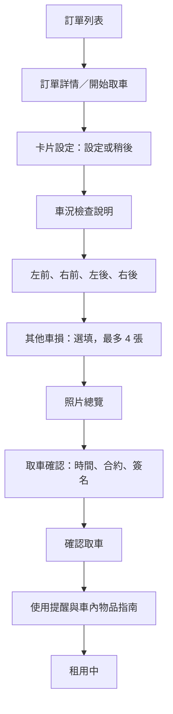
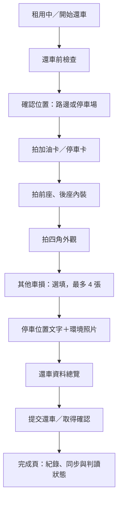

# iRent 使用者 App 實作規劃（待確認）

日期：2026-10-04。此文件供確認範圍、UI 與流程；本輪不修改 App 程式。

## 1. 參考與實作目標

依據專案內的 `取車流程圖.png`、`還車流程圖.png`，補齊從訂單、取車、用車到還車的可操作流程，並延續已整合的 Core ML 車牌偵測、OCR 與四角分類。

圖中的畫面是流程參考；圖中的費用、合約、停車規則與硬體操作，不直接當成已確認的產品規格。以下標示「建議」的內容需確認後才實作。

建議先完成**可展示的完整租還車 App**：真實使用相機與本機模型、儲存與同步照片；以明確標示的示範資料模擬訂單、車門、卡片設定、簽署及計費。雲端車況判讀接現有後端，但需要補上 App 照片與判讀服務之間的串接。

## 2. 目前已有與缺口

| 項目 | 目前狀況 | 後續內容 |
| --- | --- | --- |
| 取還車骨架 | 取車 → 租用中 → 還車 → 完成 | 增加細分步驟、訂單入口與中斷恢復 |
| 外觀拍攝 | 四角拍攝、本機辨識、車牌比對、結果顯示 | 連續拍攝導引、縮圖、重拍、其他照片類型 |
| 本機資料 | 照片與流程狀態已有儲存機制 | 多訂單、停車資料、簽署紀錄、各步驟草稿 |
| UI | Desktop App 已有藍色主題、卡片元件 | 確認維持藍色，或改為流程圖的紅色／青色 |
| 上傳 | 已有照片同步服務與接收 API | 驗證實際觸發、失敗重試、非四角照片格式 |
| 雲端判讀 | 後端已有建立、上傳、封存、查詢判讀 API | 串接四角取還車配對與內裝判讀；彙整訂單結果 |
| 用車功能 | 租用中頁面目前較簡單 | 時間、位置、開關門、延長、指南與問題回報 |
| 訂單／合約／車鎖／計費 | 尚未確認真實服務 | 第一版示範實作，真實整合另訂 API 與業務規則 |

目前 Desktop 與此 worktree 的 UI 版本不同。正式實作前先確認以 Desktop 現有主題與元件為基準，避免覆蓋已有介面改動。

## 3. 取車流程

| 頁面 | 內容與互動 |
| --- | --- |
| 訂單列表／詳情 | 已成立、已完成、已取消；顯示車型、車牌、預約時間與取還地點；狀態決定可用按鈕 |
| 卡片設定 | 設定說明、倒數與設定結果；「稍後設定」可繼續，並保留提示。第一版模擬設定結果 |
| 車況檢查 | 拍攝目的、四角示意、必拍項目與補拍入口 |
| 外觀拍攝 | 指定角度、車牌、下方縮圖列、拍攝進度；拍後顯示辨識結果與重拍建議 |
| 其他車損 | 最多 4 張，可重拍／刪除／不新增；近拍不要求出現車牌 |
| 取車確認 | 照片摘要、預計還車時間、合約／條款、手寫簽名；必填完成後才啟用確認 |
| 使用提醒 | 禁菸提醒、鑰匙與卡片等物品指南，可設定以後不再顯示 |

流程圖另有「確認車況正常，略過拍照」分支；目前 App 要求四角完成。**建議第一版保留四角必拍，取消外觀略過**，以取得取還車比較基準；這是待確認的產品選擇。

圖中的共同承租人、付費保障與行車紀錄器方案，建議放在第二階段；金額、條款、資格與簽署效力須另行提供，不直接沿用示意畫面。

## 4. 租用中頁面

上方顯示車型、車牌、租用時間與預計還車時間；中段顯示還車地點、導航與延長租用入口；下方以功能格呈現問題回報、使用指南、暫停用車、卡片設定、設備與合約。

主要操作為「開／鎖車門」與「開始還車」。模擬車門操作必須顯示「示範模式」，只有收到操作成功結果才更新狀態；重複點擊、逾時與失敗都要有對應提示。真正的車鎖、卡片與延長租用由後續正式 API 決定。

## 5. 還車流程

| 頁面 | 內容與互動 |
| --- | --- |
| 還車前檢查 | 停妥、取走物品、歸還卡片與鑰匙、熄火、關燈、關門窗等勾選項；完成後繼續 |
| 位置確認 | 地圖／地址、路邊停車格或停車場選擇；停車場顯示提示與取消還車入口 |
| 卡片照片 | 拍攝加油卡／停車卡的位置，提供示意構圖 |
| 內裝照片 | 前座、後座各一張，提供座位構圖提示 |
| 外觀／補充車損 | 沿用四角辨識與補拍流程 |
| 停車位置 | 路邊填位置描述；停車場填樓層與車位；另拍包含車輛的環境照片，支援重拍 |
| 總覽與提交 | 可返回修改各項資料；避免重複提交；失敗保留資料與重試入口 |
| 完成頁 | 還車時間、照片紀錄、待同步數量、車況判讀進度與結果 |

**圖中還車流程結束於停車位置頁的「下一步」；總覽、提交與完成頁是本規劃補充的建議。**

圖中停車位置頁提供略過選項。建議第一版要求位置文字及環境照片，方便下一位承租人找車；是否保留略過需確認。

圖中還車檢查提示「點下一步，即停止計費」。須確認實際停表點、取消還車後是否恢復計費，以及後续拍攝失敗怎麼處理。示範版可在該步記錄模擬停止時間；正式計費時間由後端確認，App 計時器僅作顯示。

## 6. 拍攝與 AI 規則

| 照片類型 | 建議數量 | 本機驗證 |
| --- | --- | --- |
| 取車四角外觀 | 4 張必拍 | 車牌偵測、OCR 比對、角度分類、影像品質 |
| 還車四角外觀 | 4 張必拍 | 同上 |
| 還車卡片 | 1 張必拍 | 基本影像品質；目前無卡片專用辨識模型 |
| 還車內裝 | 前座、後座共 2 張必拍 | 基本影像品質；目前無內裝角度專用模型 |
| 補充車損 | 每階段 0–4 張 | 基本影像品質；不要求車牌及四角分類 |
| 停車環境 | 1 張必拍（待確認） | 基本影像品質；不要求四角分類 |

基本品質檢查的亮度、模糊門檻需用實拍照片校準；未新增專用模型前，卡片／內裝／環境主體是否符合要求由拍攝提示與使用者確認輔助，不宣稱已自動辨識。

辨識失敗提供具體提示：車牌未入鏡、車牌不符、角度不符、過暗或模糊。拍攝時先保留構圖引導，拍後執行完整驗證；即時預覽推論須經實機效能量測後再加入。

每張照片保留類型、角度、時間、雜湊、本機結果、模型版本與上傳狀態。同角度重拍替換目前選用照片，補充照片有獨立 ID，不因四角完成而漏掉其他必拍項目。

「拍攝合格」只代表證據品質與車輛／角度符合要求，不能顯示成「無新增車損」。雲端車損、清潔判讀與人工覆核另有狀態，不能直接據此自動收費。

## 7. UI 風格提案

推薦保留現有 SwiftUI 卡片與元件結構，配色改為流程圖方向：**白底、紅色主要流程按鈕、青色車門操作、黑色相機介面**。也可以維持目前藍色主題；兩者待確認。

| 元素 | 建議規格 |
| --- | --- |
| 一般頁面 | 淺灰背景、白色卡片；車牌、時間與主要操作優先呈現 |
| 主色 | 紅色 `#E6002D`（提案值，非已核定品牌色） |
| 車輛操作色 | 青色 `#00A8B5`（提案值） |
| 卡片／間距 | 延續現有圓角及間距系統，避免每頁另訂樣式 |
| 導航 | 頂部返回與明確頁名；流程頁有步驟／完成數；底部主要按鈕 |
| 相機 | 黑底、大預覽、角度示意、縮圖進度、明顯快門與重拍 |
| 狀態 | 成功、警告、失敗同時使用文字與圖示，不只靠顏色 |
| 易用性 | 主要觸控區至少 48pt、支援動態字級、等待時保留回饋 |

第一版以訂單列表作為入口，不額外擴張成包含搜尋／預約／會員／支付的完整租車平台。

## 8. 資料與後端串接

新增訂單資料、取還車步驟草稿、照片種類、卡片設定狀態、停車資訊、簽名／條款版本、提交狀態與車況判讀狀態。租車狀態、目前操作步驟與同步狀態分開儲存；重開 App 能回到未完成步驟。

現有 `/v1/mobile-inspections/photos` 僅接受四角與匹配車牌，不能直接送內裝或卡片照片；需擴充或新增通用證據端點，依照片類型驗證欄位。訂單、車輛與預期車牌以後端資料為準。

現有 `/v1/inspections` 支援建立、取還照片上傳、finalize 與結果查詢；目前判讀取用每組取還照片中的一對。建議按角度建立四組配對、彙整租單結果，內裝清潔另行串接適用流程。行動端證據上傳不會自動觸發這套判讀，需補上連結。

可離線拍攝並儲存，上傳採可恢復的佇列與去重；顯示等待上傳、上傳中、失敗可重試、已上傳。正式模式只有取得後端還車確認才顯示「還車完成」；照片／AI 仍可顯示處理中，無需等待模型判讀完成。示範模式的模擬完成需清楚標示。

## 9. 實作順序與驗收

| 階段 | 交付內容 | 驗收重點 |
| --- | --- | --- |
| A：確認與整理 | 核定流程、配色、資料結構、示範範圍；對齊 Desktop UI 版本 | 每個入口與完成條件有明確定義 |
| B：取車與租用中 | 訂單、卡片設定示範、外觀／車損拍攝、確認／簽名、用車主頁 | 可完成取車；中斷重開保留草稿；未完成必填不能確認 |
| C：完整還車 | 檢查、位置、卡片／內裝／外觀拍攝、停車證據、總覽、完成 | 必拍項目逐一驗證；內裝不被車牌規則擋住；可返回修改 |
| D：同步與雲端 | 通用證據端點、重試、配對判讀、進度與人工覆核提示 | 斷網續傳不重複；提交失敗不假裝完成；模型故障不丟照片 |
| E：實機驗收 | 相機／權限、效能、背景切換、弱網、照片旋轉與重拍 | 正確／錯誤車牌、四角錯拍、EXIF 旋轉、拒絕權限、重複點擊均有合理結果 |

不把先前單張照片的模型通過結果當成所有車輛或環境的準確率；真機延遲與成功率需另以多組照片量測。

## 10. 請確認的決策

1. **實作範圍**：建議完整示範流程，真實相機／Core ML／資料同步；車鎖、卡片、計費與訂單先模擬。是否改為一開始接真實服務？
2. **UI 配色**：建議流程圖的紅色＋青色，沿用現有卡片結構；或保留目前藍色？
3. **拍攝規則**：建議取車四角必拍；還車 7 張（卡片 1、內裝 2、外觀 4）加停車環境 1 張；補充車損各最多 4 張。是否允許流程圖中的略過？
4. **停表時間**：示範版是否依圖在「還車前檢查 → 下一步」停止計時？取消還車的恢復規則也需一起確認。
5. **第二階段功能**：共同承租人、付費方案、正式合約／支付是否先延後？

確認後先實作 B、C，接著 D、E；這份文件目前為提案，不代表上述業務規則已核定。

